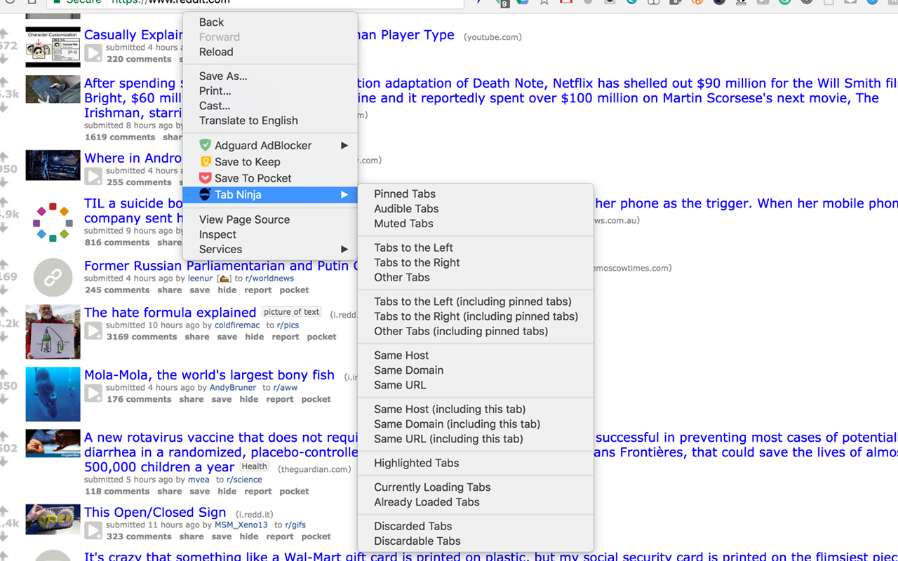

# 🗡 Tab Ninja  

Close tabs with loads of options (left, right, audible, muted, domain, url, pinned, etc)

## Screenshot

## Permissions

* `tabs` / `Read your browsing history`: Used to read tab URLs for the Same Host / Same Domain / Same URL options. Tab Ninja has no host permissions, no content scripts, and never reads page content.
* `contextMenus`: Adds the right-click menu.

Tab Ninja stores no data and makes no network requests.

## Development

1. Clone this repo
2. Go to chrome extensions [chrome://extensions](chrome://extensions)
3. Enable developer mode
4. Click on load unpacked extension and select this cloned repo

There is no build step. `npm install && npm test` runs the linter, and `npm run dist` packages `extension.zip` for the Chrome Web Store.

## License

MIT
